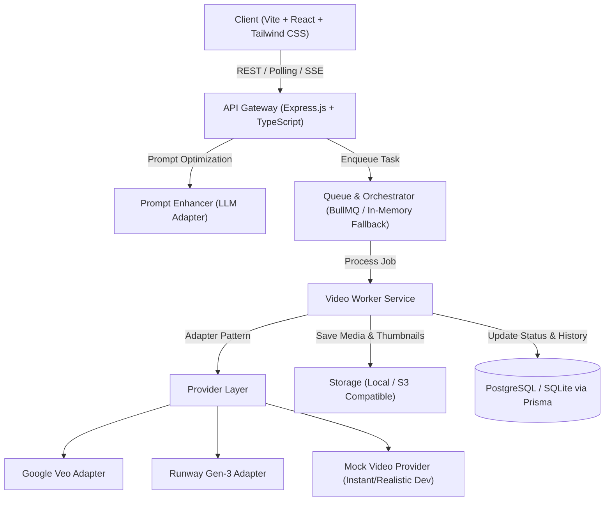

# VideoLab — AI Video Generation Platform

## 1. Overview
**VideoLab** is a provider-independent AI video generation platform that abstracts third-party generative video APIs (Google Veo, Runway Gen-2/Gen-3, Luma Dream Machine, and Mock providers) behind a standardized, resilient orchestration and queue pipeline.

---

## 2. System Architecture



---

## 3. Monorepo Structure

```
VideoLab/
├── apps/
│   ├── web/               # React + Vite + TypeScript + Tailwind CSS
│   │   ├── src/
│   │   │   ├── components/  # PromptBar, VideoPlayer, AspectRatioPicker, ModelPicker, JobDrawer
│   │   │   ├── hooks/       # useVideoGeneration, useJobTracker, useProjects
│   │   │   ├── pages/       # Studio, Gallery/Library, ProjectView, Settings
│   │   │   └── services/    # api client
│   ├── api/               # Express + TypeScript Server
│   │   ├── src/
│   │   │   ├── controllers/ # generation, projects, providers, auth
│   │   │   ├── routes/      # /api/v1/generate, /api/v1/jobs, /api/v1/models
│   │   │   ├── middleware/  # auth, error-handler, rate-limiter
│   │   │   └── services/    # promptEnhancer, storageService
│   └── worker/            # Background Worker (or embedded worker in dev mode)
│       └── src/
│           ├── queue/       # BullMQ processor + in-memory dev engine
│           └── providers/   # Provider Adapter Interface & Implementations
│               ├── base.provider.ts
│               ├── mock.provider.ts
│               ├── runway.provider.ts
│               └── google.provider.ts
├── packages/
│   ├── shared/            # Shared DTOs, Enums, Zod schemas
│   └── database/          # Prisma schema, migrations, client
├── docker-compose.yml     # PostgreSQL, Redis, API, Worker
└── package.json           # Workspace root
```

---

## 4. Key Architectural Patterns

1. **Provider Adapter Interface (`IVideoProvider`)**:
   - `generateTextToVideo(params: GenerateVideoDTO): Promise<ProviderJobResponse>`
   - `generateImageToVideo(params: GenerateImageVideoDTO): Promise<ProviderJobResponse>`
   - `checkJobStatus(providerJobId: string): Promise<JobStatusUpdate>`
   - `cancelJob(providerJobId: string): Promise<boolean>`

2. **Zero-Friction Dev Mode**:
   - Mock Provider with realistic delay simulation and curated sample video feeds so the app can be run and demonstrated immediately without API costs or external keys.
   - Hybrid Queue Engine: Supports BullMQ (with Redis) or an autonomous in-process event-driven queue when running without Docker/Redis.

3. **Prompt Enhancer**:
   - Takes concise user prompts (e.g., *"cyberpunk street in rain"*) and injects camera direction, lighting, motion descriptors, and atmospheric details suitable for generative video models.

4. **Studio UI & Media Experience**:
   - Dark-mode, glassmorphic workstation inspired by Runway, Sora, and Midjourney.
   - Multi-ratio canvas selector (16:9, 9:16, 1:1, 4:3, 21:9).
   - Real-time generation progress ring / pulse timeline.
   - Interactive player with frame-scrubbing, fullscreen, looping, and MP4 download.
